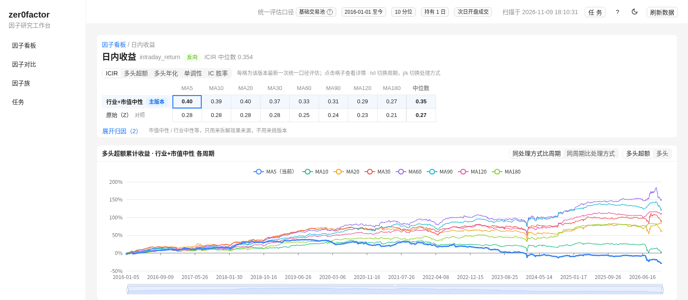
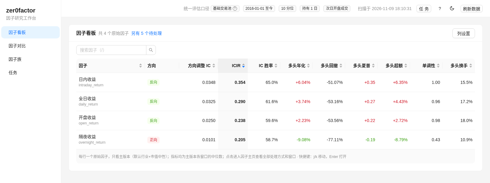
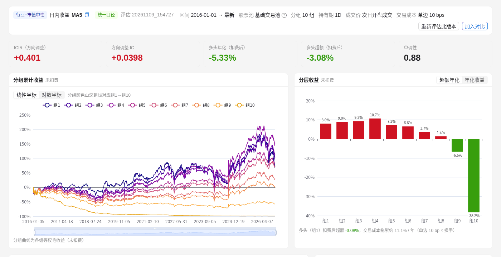
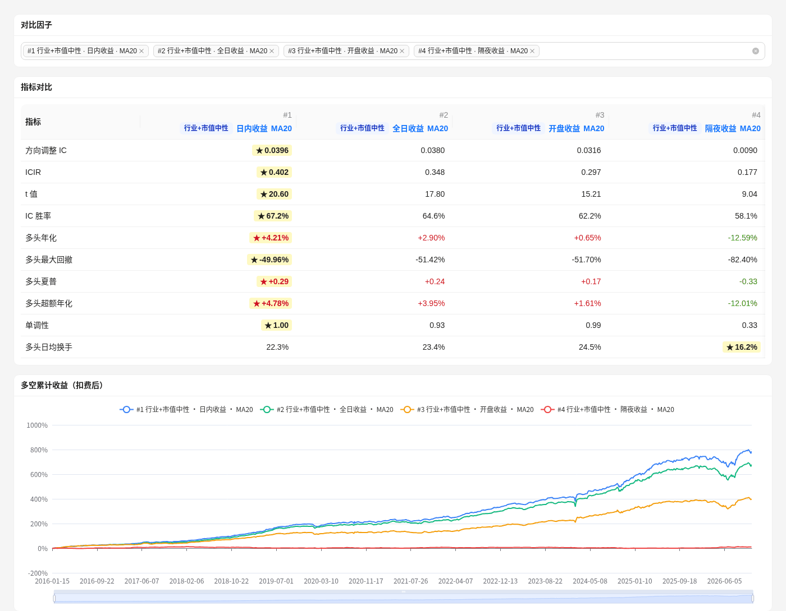

# zer0factor


[简体中文](README.md) | English

A factor research workbench for local A-share data: turn research reports and factor ideas into standard factor code, then compute, preprocess and evaluate them, and review the results in a web UI.

```text
report / idea -> FactorSpec -> compute() -> Parquet factor values -> evaluation -> web workbench
```

Data comes from the companion project [zer0share](https://github.com/zer0quant/zer0share), which syncs and queries A-share data.

> The project is still early. Treat it as a research workbench, not a production platform.



## Features

- **Standard factor contract**: `FactorSpec + FactorFrame + compute()`, unified `trade_date, ts_code, value` output
- **Storage**: Parquet partitioned by date, DuckDB registry
- **Preprocessing**: cross-sectional winsorization, standardization, industry / market-cap neutralization
- **Evaluation**: IC, quantile returns, turnover, monotonicity, portfolio metrics
- **Incremental updates**: one daily command for freshness checks, incremental builds and incremental evaluation
- **Web workbench**: board, base factor home, compare, factor families, background tasks
- **factor-research skill**: extract factors from reports, review, generate code and archive

## Install

Requires Python 3.11+, [uv](https://docs.astral.sh/uv/), and local data synced with `zer0share`. By default `zer0share` sits next to this repo; if not, change `[tool.uv.sources]` in `pyproject.toml`.

```bash
git clone https://github.com/zer0quant/zer0factor.git
cd zer0factor
uv sync
cp config/settings.example.toml config/settings.toml   # adjust data paths and date range
```

## Quick Start

```bash
uv run python main.py compute-market-cap                  # built-in market-cap factors
uv run python main.py evaluate-factor log_total_market_cap
uv run python main.py show-summary                        # inspect the results
```

Evaluation artifacts go to `data/evaluations/<run_id>/`; metric definitions are in [docs/evaluation.md](docs/evaluation.md) (Chinese).

## Keeping Data Up to Date

First, in the `zer0share` directory, sync market data and extend the universe (the universe is not extended automatically):

```bash
uv run python main.py sync --stock
uv run python main.py build-universe
```

Then, in this project, one command does the daily update (suitable for a scheduler):

```bash
uv run python main.py update-daily --notify             # every trading day: freshness check -> incremental build -> incremental evaluation -> Feishu summary
uv run python main.py update-daily --full-eval --notify # once a month: full evaluation for reconciliation
```

- The target end date is the earlier of market data and universe; if the universe lags, everything is updated to the universe's end date and a Feishu alert is sent.
- Stops at the first failing step with exit code 1. `--dry-run` only prints the plan, `--skip-eval` builds without evaluating.
- The steps can also be run one by one (`check-freshness`, `compute-returns --incremental`, `build-factors --incremental`, `evaluate-factors --incremental`); see [docs/incremental-update.md](docs/incremental-update.md) (Chinese).

## Web Workbench

```bash
cd web && npm install && npm run build && cd ..   # first time: build the frontend (Node 18+)
uv run python main.py serve                       # open http://127.0.0.1:8600
```

Numbers on the board and base factor home come from the latest run that matches the standard setting in `[web.standard]` and is evaluated to the latest date. Pages, configuration and background tasks are described in [docs/web-workbench.md](docs/web-workbench.md) (Chinese).

**Factor board**: one row per base factor; metrics are medians across the windows of its primary version.



**Version detail**: key metrics, quantile cumulative returns, quantile returns, Rank IC series and decay.



**Compare**: metrics side by side, overlaid long cumulative returns (switchable to long excess).



## Commands

Run every command as `uv run python main.py <command>`; add `--help` for full options.

| Group | Commands |
|---|---|
| Inspect | `status`, `factor-list`, `factor-info <name>`, `families` |
| Daily update | `update-daily`, `check-freshness` |
| Compute | `compute-returns`, `compute-market-cap`, `build-factors --family <name>` (all support `--incremental`) |
| Preprocess | `standardize-factor <name>`, `neutralize-factor <name>` |
| Evaluate | `evaluate-factor <name>`, `evaluate-factors <name...>` (supports `--incremental`), `evaluate-batch --file <file>` |
| Results | `show-summary`, `evaluate-summary`, `analyze-evaluation` |
| Workbench | `serve`, `web-warm --run <run_id>` |

## Writing a Factor

```python
class Ret20(Factor):
    spec = FactorSpec(name="ret20", inputs=["close"], min_window=20, frequency="1d", adjust="hfq")

    def compute(self, data: FactorFrame) -> pd.DataFrame:
        return to_factor_output(data.close / data.close.shift(20) - 1, self.spec.name)
```

Factor code only reads from `FactorFrame`; it should not read files, query DuckDB or call `zer0share` directly. See [docs/factor-contract.md](docs/factor-contract.md) (Chinese).

## Documentation (Chinese)

- [Factor contract](docs/factor-contract.md): fields, output schema, storage layout
- [Factor evaluation](docs/evaluation.md): registry, evaluation commands, artifacts, metric definitions
- [Web workbench](docs/web-workbench.md): pages, standard setting, background tasks, factor families
- [Incremental updates](docs/incremental-update.md): daily command, incremental build and evaluation
- [factor-research skill](docs/skills/factor-research/): the full report-to-factor workflow
- [TODO](docs/TODO.md) · [Devlog](docs/devlog.md) · [Contributing](CONTRIBUTING.md)

## Limitations

- Built around local A-share data and `zer0share`.
- `FactorFrame` does not yet expose ST, suspension, listed-days or exact limit-up fields.
- Families using qfq prices cannot be built incrementally; incremental evaluation supports a single holding period only.
- APIs are experimental.

## Community

The design process is documented (in Chinese) on Zhihu and the WeChat official account 极客投研笔记; see the [devlog](docs/devlog.md).

## Disclaimer

This project is for research and engineering experiments only and does not provide investment advice.

## License

MIT. See [LICENSE](LICENSE).
