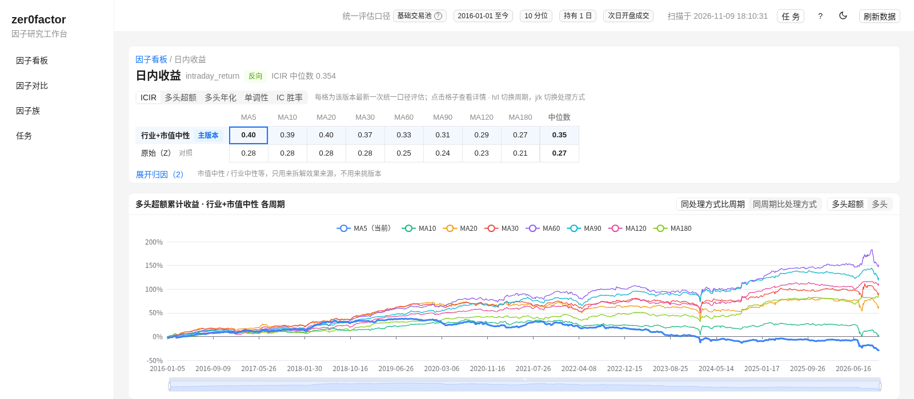
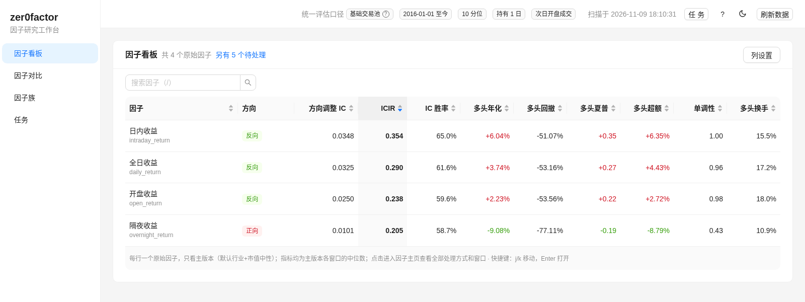
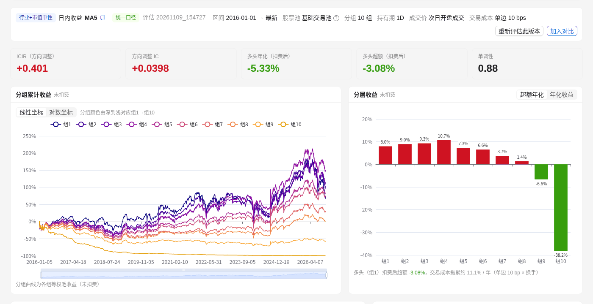
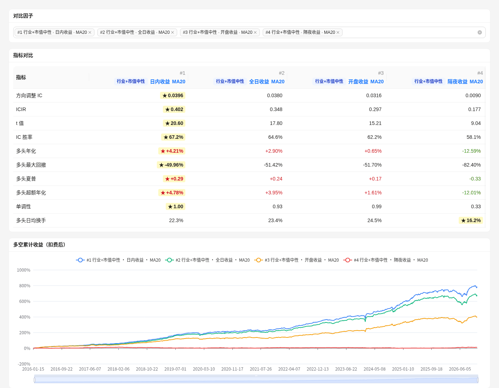

# zer0factor


简体中文 | [English](README.en.md)

面向 A 股本地数据的因子研究工作台：把研报和因子想法变成标准因子代码，再完成计算、预处理、评估，最后在网页上查看结果。

```text
研报 / 想法 -> FactorSpec -> compute() -> Parquet 因子值 -> 评估 -> Web 工作台
```

数据来自配套项目 [zer0share](https://github.com/zer0quant/zer0share)，它负责 A 股数据的同步和查询。

> 项目还在早期阶段，适合作为研究工作台使用，还不是成熟的生产平台。



## 能做什么

- **标准因子接口**：`FactorSpec + FactorFrame + compute()`，输出统一为 `trade_date, ts_code, value`
- **存储**：Parquet 按日期分区，DuckDB 作为注册表
- **预处理**：截面去极值、标准化，以及行业 / 市值中性化
- **评估**：IC、分组收益、换手、单调性、组合绩效
- **Web 工作台**：看板、因子主页、对比、因子族、后台任务
- **factor-research skill**：从研报中提取因子、审核、生成代码并归档

## 安装

需要 Python 3.11+、[uv](https://docs.astral.sh/uv/)，以及用 `zer0share` 同步好的本地数据。默认 `zer0share` 和本项目放在同级目录，位置不同的话，修改 `pyproject.toml` 的 `[tool.uv.sources]`。

```bash
git clone https://github.com/zer0quant/zer0factor.git
cd zer0factor
uv sync
cp config/settings.example.toml config/settings.toml   # 按需修改数据目录和日期区间
```

## 快速开始

```bash
uv run python main.py compute-market-cap                  # 计算内置市值因子
uv run python main.py evaluate-factor log_total_market_cap
uv run python main.py show-summary                        # 查看评估结果
```

评估结果写在 `data/evaluations/<run_id>/`，指标口径见 [docs/evaluation.md](docs/evaluation.md)。

## 更新到最新数据

先在 `zer0share` 目录下同步行情并续建股票池（股票池不会随行情自动更新）：

```bash
uv run python main.py sync --stock
uv run python main.py build-universe
```

再回到本项目，一条命令完成日更（适合放进定时任务）：

```bash
uv run python main.py update-daily --notify             # 每个交易日：截止日检查 → 增量构建 → 增量评估 → 飞书摘要
uv run python main.py update-daily --full-eval --notify # 每月一次：评估改为全量对账
```

- 目标截止日取行情和股票池中较早的一个；股票池落后时照常更新到股票池的截止日，并发飞书提醒。
- 任一步失败即停止，退出码为 1。`--dry-run` 只列出计划，`--skip-eval` 只构建不评估。
- 也可以分步执行 `check-freshness`、`compute-returns --incremental`、`build-factors --incremental`、`evaluate-factors --incremental`，用法和增量评估与全量的差别见 [docs/incremental-update.md](docs/incremental-update.md)。

## Web 工作台

```bash
cd web && npm install && npm run build && cd ..   # 首次使用：构建前端（需要 Node 18+）
uv run python main.py serve                       # 打开 http://127.0.0.1:8600
```

看板、因子主页的数字都来自 `[web.standard]` 定义的统一口径、并且评估到最新的那一次评估。页面说明、配置项和后台任务的用法见 [docs/web-workbench.md](docs/web-workbench.md)。

**因子看板**：一行一个原始因子，指标取主版本各周期的中位数。



**版本详情**：核心指标、分组累计收益、分层收益、Rank IC 序列与衰减。



**因子对比**：指标并排比较，多头累计收益曲线叠加（可切换多头超额）。



## 常用命令

所有命令都通过 `uv run python main.py <命令>` 执行，加 `--help` 查看完整参数。

| 分类 | 命令 |
|---|---|
| 查看 | `status`、`factor-list`、`factor-info <name>`、`families` |
| 日更 | `update-daily`、`check-freshness` |
| 计算 | `compute-returns`、`compute-market-cap`、`build-factors --family <name>`（均支持 `--incremental`） |
| 预处理 | `standardize-factor <name>`、`neutralize-factor <name>` |
| 评估 | `evaluate-factor <name>`、`evaluate-factors <name...>`（支持 `--incremental`）、`evaluate-batch --file <file>` |
| 结果 | `show-summary`、`evaluate-summary`、`analyze-evaluation` |
| 工作台 | `serve`、`web-warm --run <run_id>` |

## 写一个因子

```python
class Ret20(Factor):
    spec = FactorSpec(name="ret20", inputs=["close"], min_window=20, frequency="1d", adjust="hfq")

    def compute(self, data: FactorFrame) -> pd.DataFrame:
        return to_factor_output(data.close / data.close.shift(20) - 1, self.spec.name)
```

因子代码只访问 `FactorFrame`，不要自己读文件、查 DuckDB 或调用 `zer0share`。字段契约见 [docs/factor-contract.md](docs/factor-contract.md)。

## 文档

- [因子契约](docs/factor-contract.md)：字段、输出格式、存储布局
- [因子评估](docs/evaluation.md)：注册表、评估命令、产物和指标口径
- [Web 工作台](docs/web-workbench.md)：页面说明、统一口径、后台任务、因子族
- [增量更新](docs/incremental-update.md)：日更命令、增量构建与增量评估
- [factor-research skill](docs/skills/factor-research/)：从研报到因子的完整流程
- [TODO](docs/TODO.md) · [开发笔记](docs/devlog.md) · [贡献指南](CONTRIBUTING.md)

## 当前限制

- 只支持本地 A 股数据和 `zer0share`。
- `FactorFrame` 还没有提供 ST、停牌、上市天数、精确涨停等字段。
- 使用 qfq 价格的因子族不支持增量构建；增量评估只支持单一持有期。
- API 还在实验阶段。

## 交流

- 知乎：[我用 Codex，把"投资研报到股票因子"的流程做成了一个 Skill](https://zhuanlan.zhihu.com/p/2037505179373806287) / [我用 Codex + Alphalens，搭了一套适配 A 股的因子评估流水线](https://zhuanlan.zhihu.com/p/2044174825103610007)
- 微信公众号「极客投研笔记」

## 免责声明

本项目只用于研究和工程实验，不构成任何投资建议。

## License

MIT，详见 [LICENSE](LICENSE)。
